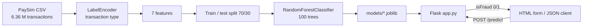

# Fraud Transaction Detection

> Random-forest classifier that flags fraudulent mobile-money transactions on the PaySim dataset, served through a small Flask form and JSON API.


## Overview

**Problem.** Fraud is a tiny fraction of payment traffic, so a model has to find a few thousand fraudulent transfers among millions of legitimate ones.

**Approach.** Train a `RandomForestClassifier` on seven per-transaction features from the PaySim synthetic mobile-money log (time step, transaction type, amount, origin and destination balances before and after), then expose it through a Flask endpoint and a one-page form.

**Result.** On a 30 % hold-out (1.9 M transactions, 2,435 frauds) the model catches **79 %** of frauds with **98 % precision** (fraud-class F1 0.87). Overall accuracy is 99.97 %, but that number mostly reflects the 0.13 % fraud rate and is not a useful measure here.

## Highlights

- End-to-end: notebook training → saved `joblib` model + label encoder → Flask `/predict` API → HTML form.
- Uses only the raw balance and amount fields; no account IDs (`nameOrig`, `nameDest`) or the dataset's rule-based `isFlaggedFraud` flag.
- Reports precision / recall for the fraud class, not just accuracy.

## Pipeline



## Results

From `notebooks/train.ipynb` (test split, `random_state=42`):

| Class | Precision | Recall | F1 | Support |
|---|---|---|---|---|
| Legitimate (0) | 1.00 | 1.00 | 1.00 | 1,906,351 |
| **Fraud (1)** | **0.98** | **0.79** | **0.87** | 2,435 |
| Macro avg | 0.99 | 0.89 | 0.94 | 1,908,786 |

<details>
<summary><b>Caveats</b></summary>

- The split is random, not time-based, so later steps leak into training; a time-ordered split would give a more realistic estimate.
- No class weighting, threshold tuning or PR-AUC analysis was done; the model uses the default 0.5 threshold.
- PaySim is synthetic. Its balance fields make fraud unusually easy to spot (fraudulent transfers typically empty the origin account), so results will not transfer directly to real payment data.
</details>

## Tech stack

| Area | Tools |
|---|---|
| Model | scikit-learn `RandomForestClassifier`, `LabelEncoder` |
| Data | pandas |
| Serving | Flask, joblib |
| UI | Plain HTML/CSS + `fetch` |

## Project structure

```text
Fraud-Transaction-Detection/
├── app.py                         # Flask app: GET / (form), POST /predict (JSON)
├── models/
│   ├── fraud_detection_model.joblib   # trained random forest (~24 MB)
│   └── type_encoder.joblib            # transaction-type encoder
├── notebooks/
│   └── train.ipynb                # load data, train, evaluate, save models
├── templates/
│   └── index.html                 # input form
├── requirements.txt
└── LICENSE
```

## Getting started

```bash
git clone https://github.com/rupeshbharambe24/Fraud-Transaction-Detection.git
cd Fraud-Transaction-Detection
python -m venv venv && source venv/bin/activate   # Windows: venv\Scripts\activate
pip install -r requirements.txt
python app.py                                     # http://127.0.0.1:5000  (FLASK_DEBUG=1 for debug mode)
```

The trained model is committed, so the app runs without retraining. `scikit-learn` is pinned to 1.6.1, the version the model was saved with.

### API

```bash
curl -X POST http://127.0.0.1:5000/predict \
  -H "Content-Type: application/json" \
  -d '{"step": 1, "type": "TRANSFER", "amount": 181, "oldbalanceOrg": 181,
       "newbalanceOrig": 0, "oldbalanceDest": 0, "newbalanceDest": 0}'
# {"isFraud": 1}
```

`type` is one of `CASH_IN`, `CASH_OUT`, `DEBIT`, `PAYMENT`, `TRANSFER`.

### Retrain

1. Download the PaySim CSV from Kaggle: [Synthetic Financial Datasets For Fraud Detection](https://www.kaggle.com/datasets/ealaxi/paysim1) (CC BY-SA 4.0).
2. Save it as `data/FraudTransactionDetection.csv` (git-ignored).
3. Run `notebooks/train.ipynb`; it writes the model and encoder to `models/`.

## Dataset

PaySim (E. A. Lopez-Rojas, A. Elmir, S. Axelsson, 2016) simulates one month of mobile-money transactions from an African mobile-money service: 6,362,620 rows, of which 8,213 are fraud. It is not included in this repository.

## License

Code: [MIT](LICENSE). Dataset: see its Kaggle page.
